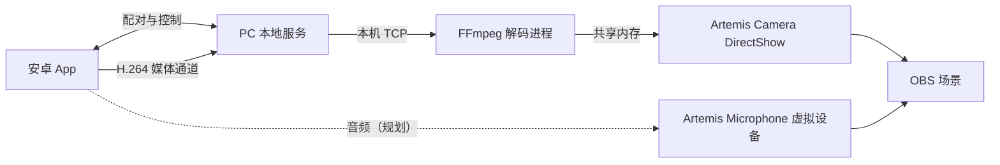

# Artemis 产品规划

> 版本：v0.2  
> 日期：2026-11-02  
> 项目目录：`C:\workspace\Artemis`  
> 状态：产品规划。M0 技术预研执行中：手机视频链路已实现并验证，音频与真机验证基线未完成。本文的性能指标为验收目标，不代表已经达到。

## 1. 产品定位

Artemis 是一个免费的手机音视频采集工具：手机安装安卓 App，连接同一局域网内的电脑，将摄像头画面和麦克风收音同步传入 OBS。

一期以“稳定、易连接、可持续使用”为核心，不依赖付费订阅、账号体系或云端转发。用户已有的安卓手机可以作为电脑的外置摄像头和麦克风。

项目名称暂按新目录统一使用 **Artemis**。产品说明可使用：**把手机变成电脑的摄像头和麦克风。**

### 1.1 已确定的产品方向

- 手机侧采用原生安卓 App，便于后续集成设备控制和其他功能。
- 独立新建工程，RemoteCam 作为技术参考，不沿用其 MJPEG 传输架构。
- 手机摄像头和麦克风一起传输，一期收音指手机内置麦克风收到的声音。
- 一期电脑侧以 Windows + OBS 为目标。
- 最低支持 Android 10，首个重点验证环境为三星 S24 / Android 16。
- 后续增加 vivo 新机的真机验证；具体型号和系统版本以拿到设备后的实际信息为准。
- 手机 App、电脑本地服务与 Windows 系统虚拟设备放在同一个仓库，统一维护配对、控制与媒体协议。
- 媒体以 H.264 over TCP 传输，电脑侧解码后写入共享内存，由系统设备呈现；OBS 只作为验收代表。

### 1.2 一期使用边界

一期面向可信的家庭或工作室局域网，一部手机连接一台电脑、同一时间一个活动会话。电脑可以使用有线网络，手机使用同一路由器的 Wi-Fi。

访客 Wi-Fi 隔离、跨网段限制、VPN 路由和电脑防火墙可能影响连接，客户端应提供可理解的失败提示。

## 2. 典型使用流程

1. 用户在电脑上启动 Artemis，控制页显示本机状态与可连接的手机。
2. 用户打开手机 App，App 自动发现同一局域网内的电脑；不需要扫码或输入地址。
3. 电脑控制页单击选择这部手机；手机首次选择「允许并记住」，之后免配对。
4. 用户授予摄像头权限（音频实现后增加麦克风权限），选择镜头和画质。
5. 连接建立后手机开始采集，App 显示连接与采集状态；主动断开即停止。
6. 用户打开 OBS，在「视频采集设备」中选择 `Artemis Camera`；音频实现后在「音频输入采集」中选择 `Artemis Microphone`。
7. OBS 显示手机画面，音频混音器显示手机收音电平，可以进行录制或直播。
8. 用户停止后，手机释放摄像头和麦克风，电脑端同步显示已停止。

控制页只负责配对、连接与状态展示；媒体由 Windows 系统设备消费，不再有 OBS 浏览器接收页。

## 3. 技术路线

### 3.1 总体架构



电脑本地服务负责发现、配对、连接状态与媒体转发；媒体由手机 H.264 编码后经 TLS 通道送到电脑，Node 只转发不转码。解码进程把画面写入共享内存，DirectShow 过滤器以 `Artemis Camera` 提供给 OBS 及其他应用。麦克风经虚拟音频设备成为系统输入，尚未实现。

### 3.2 安卓 App

| 层次 | 计划技术 | 职责 |
| --- | --- | --- |
| 开发语言 | Kotlin | 应用逻辑、设备能力查询与连接管理 |
| 界面 | Jetpack Compose | 配对、预览、参数设置与状态显示 |
| 视频采集 | Camera2 | 前后摄像头输出到编码器 Surface |
| 视频编码 | MediaCodec（H.264） | 硬编、低延迟、720p30 基线 |
| 音频 | 待确定 | 内置麦克风采集、编码与静音（未实现） |
| 连接 | OkHttp WebSocket + TLS 固定 | 控制连接与独立媒体连接 |
| 持续运行 | Android 前台服务 | 采集通知与停止入口（未实现，当前仅前台常亮） |

采集与编码在后台线程运行，界面只处理状态和交互。相机、麦克风、连接状态分别管理，避免参数变化时无差别重建整条链路。当前原型连接后自动启用摄像头，显式的开始/停止与前后摄切换属于后续交互完善。

### 3.3 音视频格式

- 视频采用 H.264（MediaCodec 硬编），默认 720p / 30 fps、4 Mbps，10 秒 I 帧，静止时补帧。
- 1080p / 30 fps 作为设备支持时的可选档位，需过滤器放开多分辨率协商。
- 音频编码与传输在音频设备 Spec 中确定，首版以语音收音为主要场景；当前没有音频帧类型。
- 媒体帧带 PTS；音画同步方案随音频 Spec 确定并实测，验收仍需测量实际偏差。
- 硬件编码不可用、设备过热或网络不足时，应允许降低画质；不承诺所有手机达到相同画质和帧率。

### 3.4 电脑侧

| 部分 | 计划技术 | 一期职责 |
| --- | --- | --- |
| 本地服务 | Node.js + TypeScript | 发现、配对、会话、控制页与媒体转发（不转码） |
| 控制页面 | 轻量网页 | 列出手机、单击连接、显示连接状态 |
| 媒体接收 | 原生接收进程 | 终止 TLS 后的媒体连接落到本机解码进程 |
| 解码 | FFmpeg | H.264 解码并转 BGRA |
| 系统摄像头 | DirectShow 过滤器 + 共享内存 | 提供 `Artemis Camera` 给 OBS 及其他应用 |
| 系统麦克风 | 虚拟音频驱动 | 提供 `Artemis Microphone`（未实现，需内核驱动） |
| 分发方式 | Windows 安装包 / 便携包 | 包含运行时与启动入口，使用者无需开发环境 |

一期不要求 OBS 插件：摄像头与麦克风都以系统设备出现，OBS 只作为验收代表。运行时不加载第三方 CDN 资源。

### 3.5 连接与配对原则

- 电脑在局域网广播发现服务，手机自动发现并建立受限 presence；电脑控制页单击选择手机。
- 首次连接由手机允许一次并记住电脑身份，之后重开 App、服务重启或短暂掉线都免配对；不靠 IP 或扫码取得权限。
- 配对与信任可以撤销；用户主动断开后停止重连。当前原型在连接或恢复后会自动启用摄像头，显式采集意图与开关属于后续交互完善。
- 短暂断网期间保留连接意图，网络恢复且会话有效时尝试重连；用户主动停止后不再自动重连。
- 同一时间只允许一个活动会话；第二台电脑需要用户明确切换。
- 控制连接与媒体连接都使用本地自签名 TLS 与 SPKI 固定；媒体连接复用配对结果，不以“知道 IP”作为授权。

## 4. Android 版本与适配策略

### 4.1 版本基线

| 配置/范围 | 一期规划 |
| --- | --- |
| 最低支持系统 | **Android 10 / API 29** |
| 最低 SDK 配置 | **`minSdk = 29`** |
| 首版目标行为基线 | Android 16 / API 36，计划 `targetSdk = 36` |
| 编译 SDK | 首选 API 36；若选定依赖要求更高编译 SDK，再单独调整并验证 |
| 首个重点验收设备 | 三星 Galaxy S24 / Android 16 |
| 后续跨品牌设备 | 用户计划更换的 vivo 新机，型号及系统版本待实机确认 |
| 华为设备 | 暂不纳入一期适配与验收范围 |

`minSdk` 决定最低允许安装的版本；`targetSdk` 决定应用适配的系统行为。两者不需要相同。[Android SDK 配置说明](https://developer.android.com/guide/topics/manifest/uses-sdk-element)

Android 16 对应 API 36。该基线用于首版开发和验收，不表示 Android 16 是产品支持的最高版本；后续系统升级仍需验证。[Android 16 SDK 说明](https://developer.android.com/about/versions/16/setup-sdk)

Android 10 是兼顾旧手机利用价值与初期开发成本的产品选择，不是摄像头、麦克风功能的技术最低门槛。支持 Android 10 及以上是设计目标，实际已验证范围需在发布说明中单独列出。

### 4.2 系统与品牌差异

- 共用一套 APK，不按三星、OPPO、vivo 分别维护独立应用。
- 使用标准 Android 接口和能力查询，不硬编码摄像头编号或依赖三星专有接口。
- 一期提供系统公开的前后摄像头；广角、长焦等附加镜头不作为所有机型的必备能力。
- 按 Android 版本处理摄像头、录音、通知和前台服务权限；不通过降低目标 SDK 回避新系统规则。
- 用户在可见界面开始采集，后续以 `camera|microphone` 类型的前台服务管理采集并显示可停止的通知（当前原型尚未接入前台服务）。
- 一期按前台边界使用：App 前台且未锁屏时采集；切其他 App 或锁屏暂停连接与采集，返回并解锁后恢复原电脑。不承诺后台持续采集。[前台服务官方说明](https://developer.android.com/develop/background-work/services/fgs/service-types)
- 先完成 S24 的切后台/锁屏暂停与返回恢复验证；其他机型的省电策略单独记录。
- vivo 等机型增加省电策略及后台限制测试；需要用户调整设置时，提供对应说明，不默认要求所有用户关闭省电保护。

### 4.3 兼容验证分层

1. Android 10 进行最低版本安装、启动、权限流程和基础功能验证；真实音视频能力应在可用的对应版本真机上补验。
2. Android 12、13、14 等关键版本验证服务启动、通知和权限行为差异。
3. Android 16 / S24 完成音视频、同步、性能、重连及持续运行验收。
4. 新 vivo 设备到位后，使用同一 APK 执行跨品牌回归。
5. 模拟器验证不能替代相机、麦克风、硬件编码及锁屏行为的真机验证；缺少设备时明确标注“未实测”。

## 5. 一期功能范围

| 编号 | 功能 | 一期要求 |
| --- | --- | --- |
| P1-01 | 手机连接电脑 | 自动发现局域网电脑，电脑单击选择；手机首次允许一次，后续免配对 |
| P1-02 | 摄像头推流 | 前后摄像头选择、本地预览、画质选择、开始与停止 |
| P1-03 | 麦克风推流 | 内置麦克风与视频同步发送，支持麦克风静音开关 |
| P1-04 | OBS 接入 | OBS「视频采集设备」选 `Artemis Camera`，「音频输入采集」选 `Artemis Microphone`；说明设备选择与控制 |
| P1-05 | 连接状态 | 显示待连接、连接中、已连接、采集中、重连中及错误原因 |
| P1-06 | 断线恢复 | 处理 Wi-Fi 短暂断开、解码进程/电脑服务重启；需要重新配对时明确提示 |
| P1-07 | 持续运行 | 前台服务通知含停止入口；按前台边界验证切后台/锁屏暂停与返回恢复 |
| P1-08 | 停止与释放 | 停止后关闭采集和连接，释放相机、麦克风，恢复可再次启动的状态 |
| P1-09 | 电脑启动与引导 | Windows 安装包/便携包、本地控制页、配对及 OBS 使用说明 |
| P1-10 | 基本诊断 | 显示实际分辨率、帧率和连接状态，提供不含配对凭据的诊断日志 |

必要权限被拒绝、摄像头被其他应用占用、地址不可达或设备不支持某档画质时，应给出明确反馈，不闪退、不长期停留在无说明的黑屏状态。

## 6. 一期不包含的能力

- iPhone App、手机免安装网页发送端。
- OBS 原生插件（摄像头与麦克风已作为系统设备提供，不需要插件）。
- 互联网远程连接、跨 NAT 穿透、云端 TURN 转发。
- USB 直连和多手机同时接入、多接收端同时观看。
- 手机内部 App 声音、通话音频采集。
- 蓝牙、USB、有线外置麦克风及外置摄像头的通用兼容承诺。
- 美颜、滤镜、背景抠像、AI 功能、复杂手动相机参数。
- 4K、高帧率、HDR 以及所有物理镜头的完整支持。
- 手机或电脑录制文件管理、云存储、账号、付费体系和应用商店发布。
- 所有机型锁屏后都能持续采集的承诺。

OBS 录制与直播可以直接使用 `Artemis Camera` 与 `Artemis Microphone`。会议软件可把两者作为普通摄像头和麦克风使用，但逐个应用的兼容性不作为一期验收内容。

## 7. 一期验收目标

验收基准为 S24 / Android 16、Windows 电脑、固定并记录版本的 OBS，以及信号良好、无客户端隔离的同一局域网。默认使用 720p / 30 fps；1080p 档位另行记录结果。

| 验收项 | 目标及验证方式 |
| --- | --- |
| 首次连接 | 按使用说明，完成电脑启动、手机配对及 OBS 选择 `Artemis Camera` / `Artemis Microphone`，无需修改代码 |
| 音视频接收 | OBS 持续显示画面和麦克风电平，录制回看可确认声音与画面均有效 |
| 基础画质 | 在基准环境下支持 720p / 30 fps，记录实际帧率；连续测试中不出现反复长时间停帧 |
| 音画同步 | 拍手或口型录制测试，目标绝对偏差不超过 150 ms；测量方法和结果写入测试报告 |
| 端到端延迟 | 720p 档位目标不超过 300 ms，通过同框计时等方式测量；超标需定位并说明，不宣称已经达标 |
| 连续运行 | 连续推流至少 30 分钟，无崩溃、无持续黑屏、无麦克风永久失声，记录温升与掉帧现象 |
| 切后台/锁屏 | S24 上切其他 App 或锁屏后暂停采集，返回并解锁后自动恢复原电脑；不要求后台持续采集 |
| 断网重连 | 会话仍有效时，短暂断网后恢复网络，目标 10 秒内恢复媒体；失效会话明确要求重新连接 |
| 重复启停 | 连续执行至少 10 次开始/停止，均能重新取得设备，停止后采集指示结束 |
| 接收端恢复 | 解码进程或电脑服务重启后能恢复画面，不要求强制结束手机进程 |
| 权限与异常 | 拒绝相机/麦克风权限、设备占用、错误地址均有提示和恢复入口，不闪退 |
| 离线运行 | 断开公网但保留局域网后，仍可完成首次配对、建立媒体连接及重新连接 |
| 分发可用 | 在无 Node.js 开发环境的目标 Windows 电脑上，安装包/便携包可启动并提供控制页与系统设备 |

一期开启 1080p 时的帧率、锁屏表现和其他品牌表现作为单独能力结果记录。若验收目标需要调整，应记录原因和新边界，不把未通过的目标标记为完成。

## 8. 开发阶段与交付物

| 阶段 | 工作重点 | 完成标志 |
| --- | --- | --- |
| M0 技术预研 | 验证 H.264 over TCP、S24 采集、DirectShow 摄像头、虚拟麦克风、配对与本地证书信任 | 最小音视频链路可用，系统设备能被 OBS 枚举 |
| M1 基础工程 | 建立安卓端、PC 服务、控制页与原生设备骨架；固定开发工具链和目录结构 | 可重复构建 APK、启动电脑服务与 `Artemis Camera`，协议和状态定义清楚 |
| M2 一期功能 | 完成配对、预览、音视频发送、系统设备接入和基础设置 | 主要使用流程贯通 |
| M3 稳定性与兼容 | 处理重连、服务生命周期、权限、画质降级及版本差异 | 核心验收通过，未验证设备与能力单独登记 |
| M4 发布准备 | 打包 APK、Windows 安装包/便携包、使用指南和测试报告 | 普通使用者可按说明完成连接，无需开发环境 |

一期交付物：

- 安卓 APK 与可复现构建的源码。
- Windows 安装包/便携包（接收服务、解码进程、DirectShow 过滤器、虚拟音频驱动）。
- 首次使用、OBS 设备选择、网络排查和停止采集说明。
- 已验证的设备/系统/OBS 版本列表与测试报告。
- 第三方依赖来源、版本和许可证清单。

## 9. 建议仓库结构

```text
Artemis/
├─ android/       # 安卓 App
├─ receiver/      # PC 本地服务与控制页（配对/转发）
├─ native/        # DirectShow 过滤器、解码进程与系统音频设备
├─ protocol/      # 配对、媒体帧头、错误码与状态约定
├─ docs/          # 技术设计、使用说明与测试报告
└─ 产品规划.md    # 本文
```

这里只约定职责，不要求一期把每个目录拆成独立发布的软件包。Android 工具链、FFmpeg 与 Node.js 运行时版本在 M0/M1 锁定，避免照搬旧项目依赖。

## 10. 后续演进方向

- 增加 vivo、OPPO 等代表机型验证，完善画质、镜头和电源策略适配。
- 根据实际使用反馈增加曝光、对焦、方向锁定和更细的音频设置。
- 复用 PC 接收与信令约定，增加免安装的手机网页发送端。
- 在需求明确后评估 USB、外置麦克风、多机位、会议软件音频路由与其他桌面平台。

后续能力独立规划，不作为一期完成的前置条件。

## 修订记录

| 版本 | 日期 | 说明 |
| --- | --- | --- |
| v0.1 | 2026-10-28 | 初版：WebRTC + OBS 浏览器源路线 |
| v0.2 | 2026-11-02 | 按 D-007～D-011 改为 Windows 系统摄像头/麦克风；同步 H.264 over TCP、自动发现配对、前台使用边界与交付形态 |
